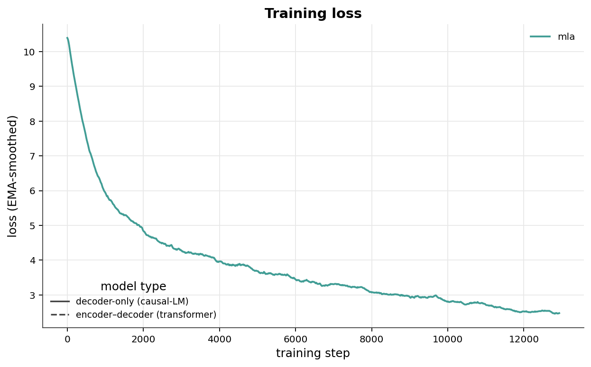
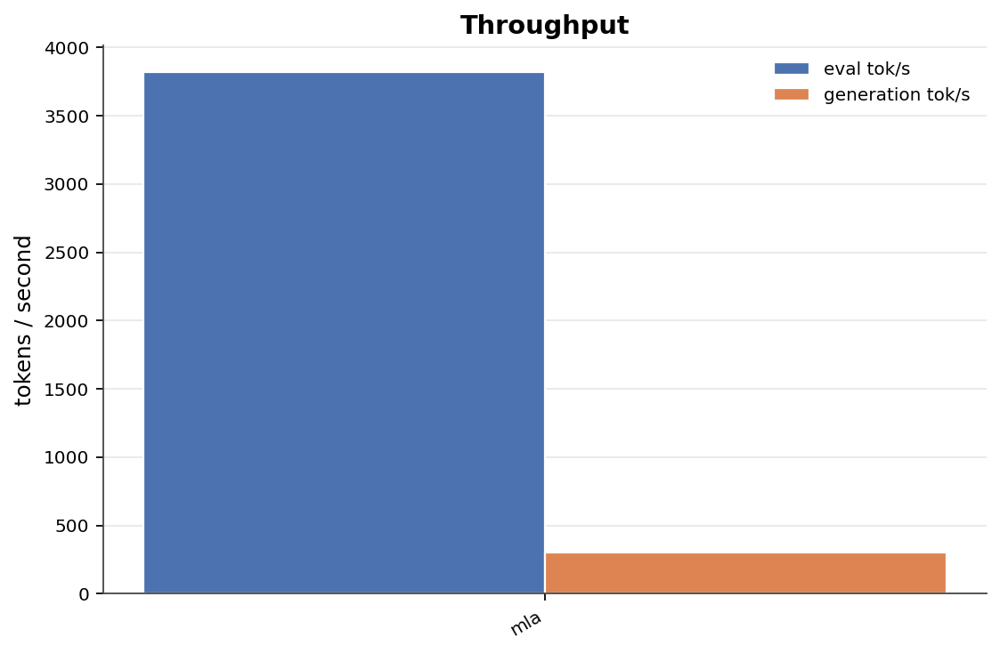
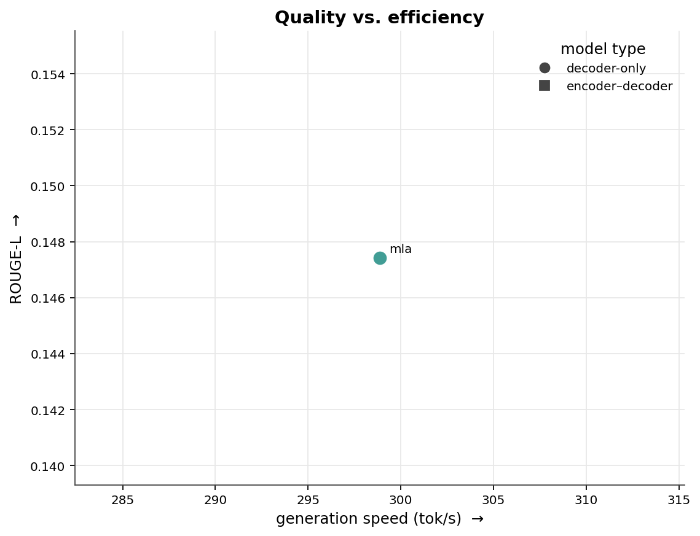
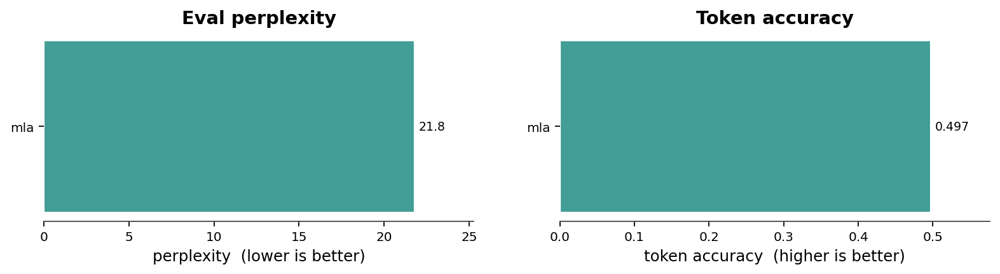
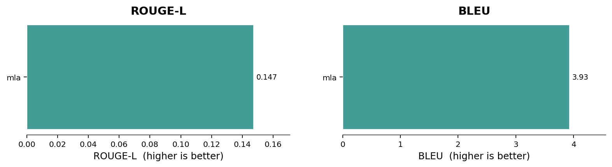
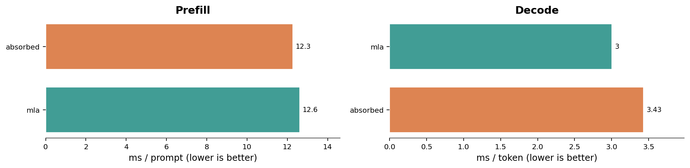

# Transformer Lab — Attention Benchmark

Attention variants trained on MeetingBank, grouped into the two model families they were trained in — **encoder–decoder transformers** and **decoder-only (causal-LM)** models. Because the families optimise different objectives, the quality metrics are benchmarked **separately per family**; only the cross-cutting views (training loss, throughput, and the speed/quality overview) place them on a shared axis.

**Setup** — dataset `meetingbank` / `validation` · generation samples `128` · precision `fp32` by checkpoint · [model collection](https://huggingface.co/collections/Pradheep1647/transformer-lab-6a07fe3185f5728e217997e0).

## Training loss



Training loss vs. step, pulled from each model's `loss_curve.csv` on the Hub and exponentially smoothed. **Solid** lines are decoder-only / causal-LM models (mla); **dashed** lines are encoder–decoder transformers. Shown together for reference, but the two families optimise different objectives so absolute loss is not directly comparable.

## Throughput



Evaluation and autoregressive-generation speed in tokens per second — the metric that is directly comparable across both families.

## Quality vs. efficiency

> Cross-family overview only. ROUGE-L against generation speed for all variants (circles = decoder-only, squares = encoder–decoder). Quality is *not* comparable across families — see each family's own section below for the head-to-head numbers.



## Encoder–decoder transformers

<details>
<summary>Raw metrics — Encoder–decoder transformers</summary>

| Attention Variant | Repo | Status | Loss | PPL | Tok Acc | ROUGE-L | BLEU | Tok/s | Gen tok/s |
|---|---|---:|---:|---:|---:|---:|---:|---:|---:|

</details>

## Decoder-only (causal-LM)

> **Why this family scores much lower on generation.** Encoder–decoder models get cross-attention that aligns the decoder directly to the source transcript, making the copy-heavy summarization task far easier; decoder-only models must learn that purely in-context. These models also compress or sparsify the KV cache, discarding source detail that copying needs, and they show the classic teacher-forcing gap — msa reaches the lowest perplexity of any model yet near-zero BLEU, because low next-token loss does not survive free-running generation. Compare these variants against each other, not against the encoder–decoder family above.

**Highlights**

- Lowest perplexity — **mla** (21.8).
- Best generation overlap (ROUGE-L) — **mla** (0.147).
- Fastest generation — **mla** (299 tok/s).

### Evaluation quality



Teacher-forced perplexity (lower is better) and next-token accuracy on the held-out validation split.

### Generation quality



Summary-generation overlap against reference summaries (ROUGE-L and BLEU).

<details>
<summary>Raw metrics — Decoder-only (causal-LM)</summary>

| Attention Variant | Repo | Status | Loss | PPL | Tok Acc | ROUGE-L | BLEU | Tok/s | Gen tok/s |
|---|---|---:|---:|---:|---:|---:|---:|---:|---:|
| mla (multi-head latent attention) | [`junuxyz/mla-meetingbank-bs8-e20-fp32-12`](https://huggingface.co/junuxyz/mla-meetingbank-bs8-e20-fp32-12) | ok | 3.082 | 21.79 | 0.4969 | 0.1474 | 3.931 | 3823 | 298.9 |

</details>

## Models

**Decoder-only**

-  **mla** [`junuxyz/mla-meetingbank-bs8-e20-fp32-12`](https://huggingface.co/junuxyz/mla-meetingbank-bs8-e20-fp32-12) (ok)

## Standard vs Absorbed

Weight absorption is a training-free inference trick, which avoids per-head K/V reconstruction by moving the key projection to the query path and the value projection after attention. Enable weight absorption by setting `weight_absorption: true` in the MLA config (default: `false`). See [PR #4](https://github.com/Mantissagithub/transformer-lab/pull/4) for details.

Measured both standard and absorbed on Apple M5 Pro (MPS) in FP32, with batch size 1, 512 token input prompt and 64 decode steps. Both paths use identical synthetic tokens. Timings are medians of five runs. Token selection and EOS handling are excluded from these forward timings.


```bash
uv run --extra benchmark python scripts/benchmark_mla.py \
  --repo-id junuxyz/mla-meetingbank-bs8-e20-fp32-12 \
  --device mps
```




| Forward latency | Standard | Absorbed |
|---|---:|---:|
| Prefill, ms / prompt | 12.61 | 12.27 |
| Decode, ms / token | 3.00 | 3.43 |

**Correctness**

Logits matched within `atol=1e-5, rtol=1e-4`, with identical top-1 predictions.

**Performance**

Avoiding per-head K/V reconstruction at each decode step was expected to reduce latency, but absorption was **slower** in this configuration. Controlled comparisons indicate that at these small tensor sizes, the extra batched matrix multiplications and K/V layout handling cost more than the K/V reconstruction they eliminate.

[Comparison script](../../scripts/benchmark_mla.py) · [Raw results](standard_vs_absorbed.json)
